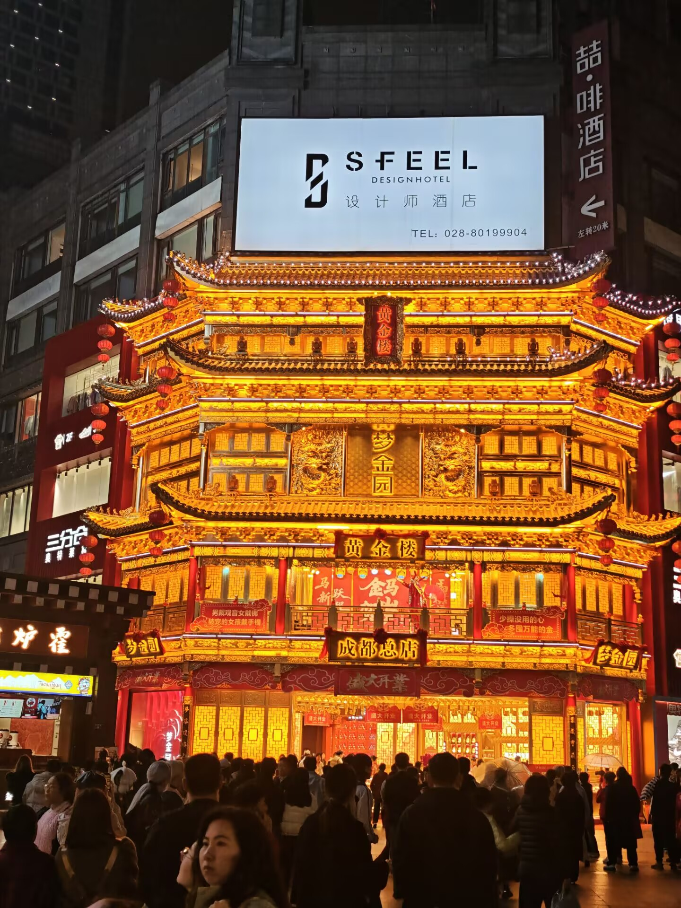
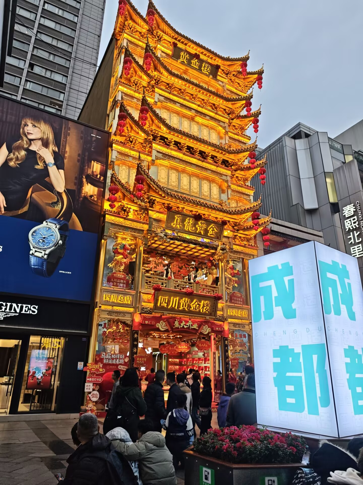
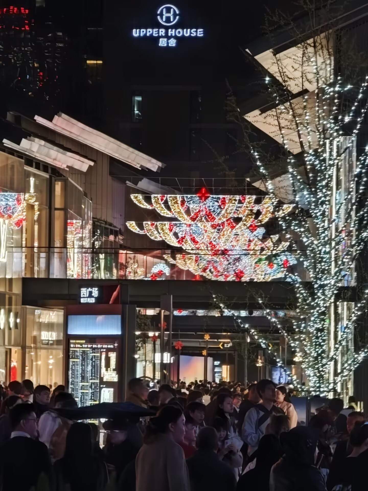
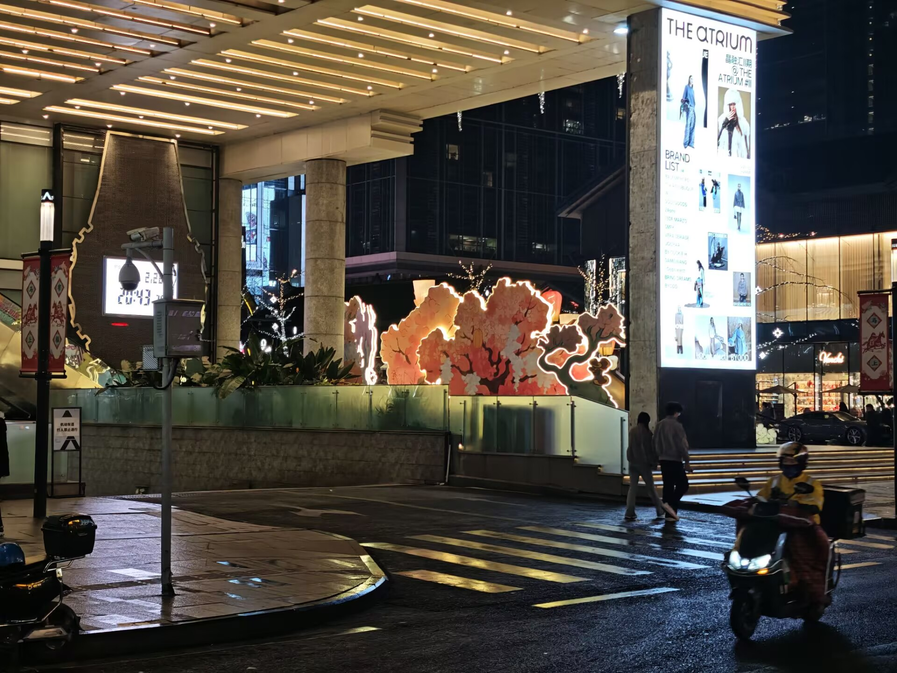
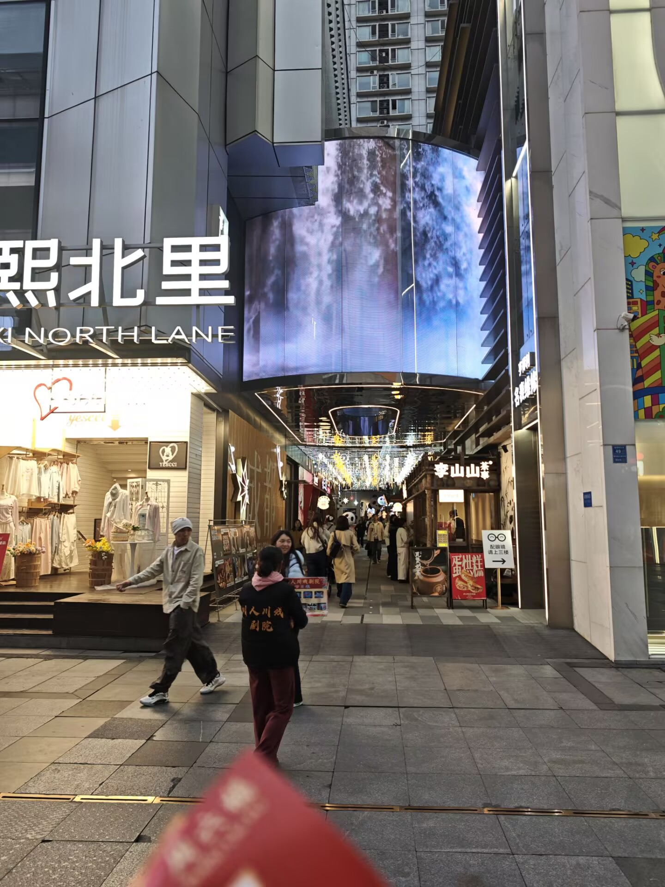
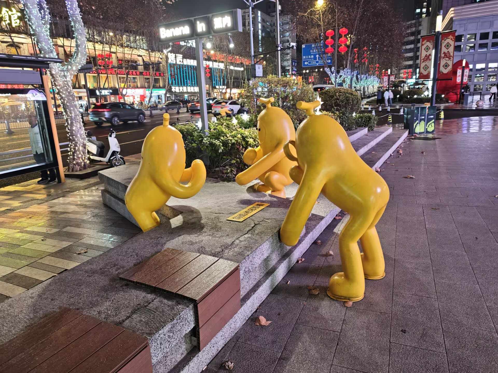
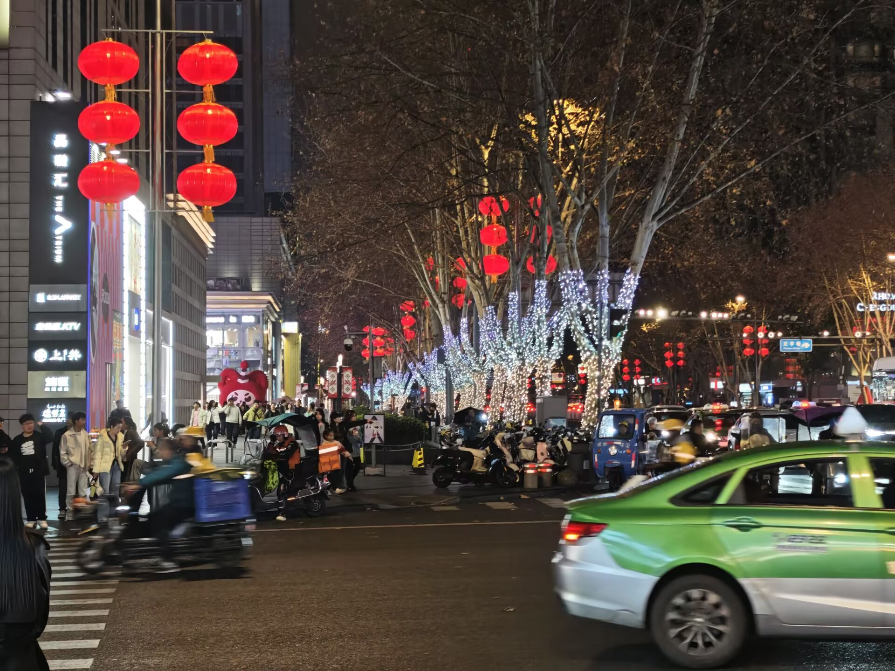
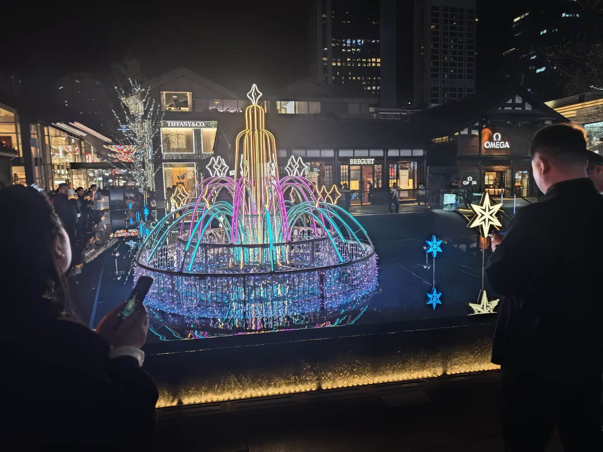

成都的市中心有一条不必刻意去找的街——春熙路。地铁出来就是人潮，商场、老字号、小吃摊挤在同一条街面上，白天是逛街的地方，晚上是看灯的地方。

## 黄金楼

春熙路最好认的地标之一是那栋「黄金楼」——整栋仿古建筑贴金描彩，白天看着已经够张扬，到了晚上灯一亮，简直像镀了层真金，隔着半条街都晃眼。

## 太古里的夜

往东一拐就是远洋太古里，青瓦坡屋顶的低层建筑群。入夜之后树上缠的灯带和半空的灯饰一起亮起来，人流比白天更密。

## 街头即景

商场里外散落着各种巨型艺术装置，逛累了抬头撞见一个，也算这条街的彩蛋。

---

春熙路算不上「景点」，更像是成都日常生活的一部分——想感受这座城市的节奏，在这儿走一圈就够了。
