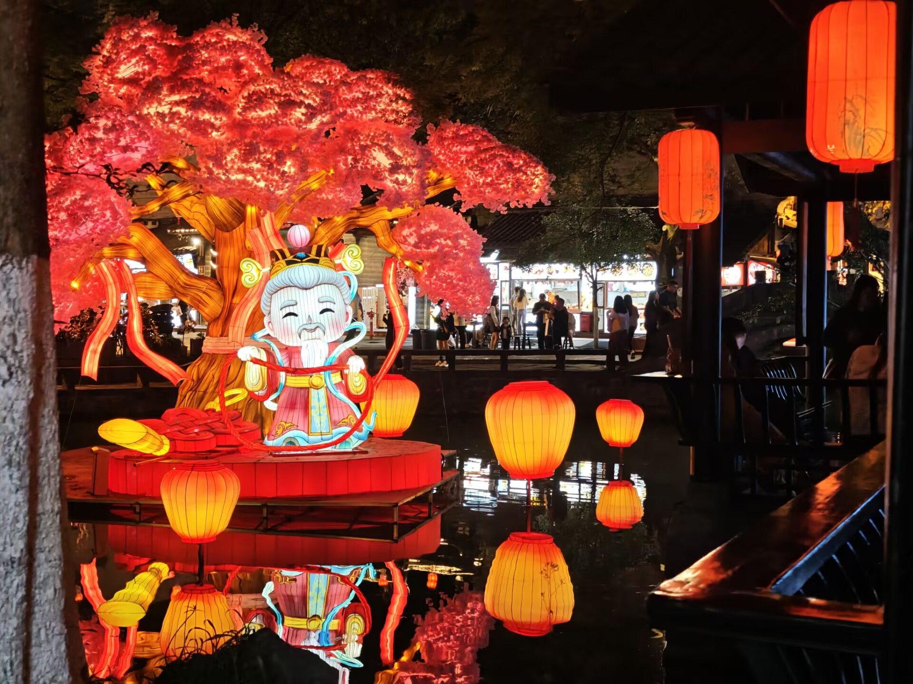
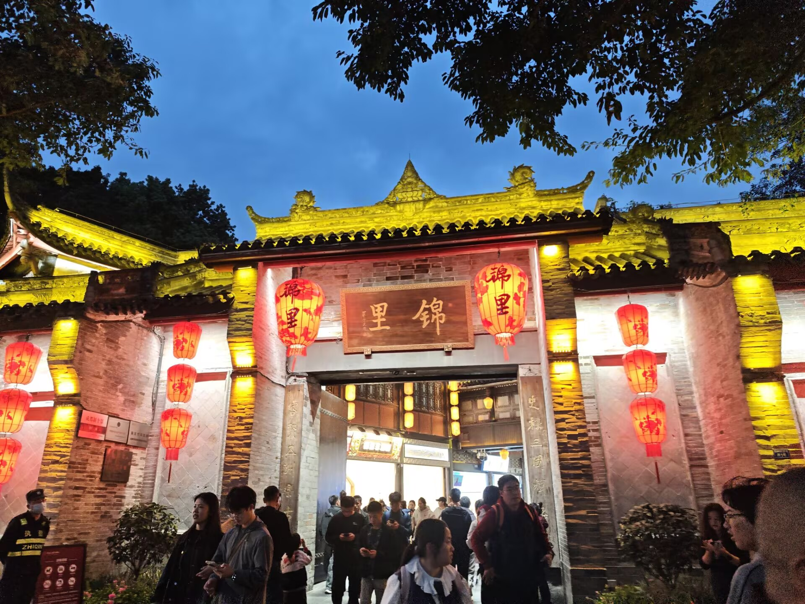
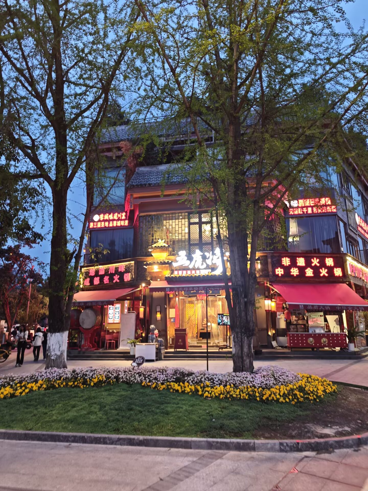
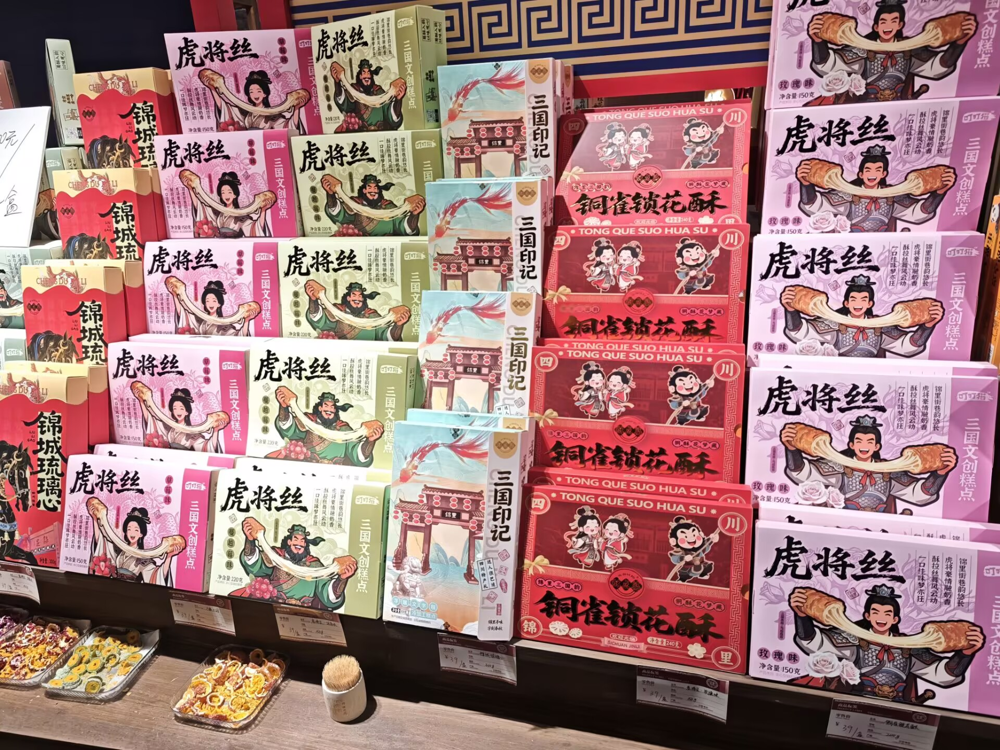
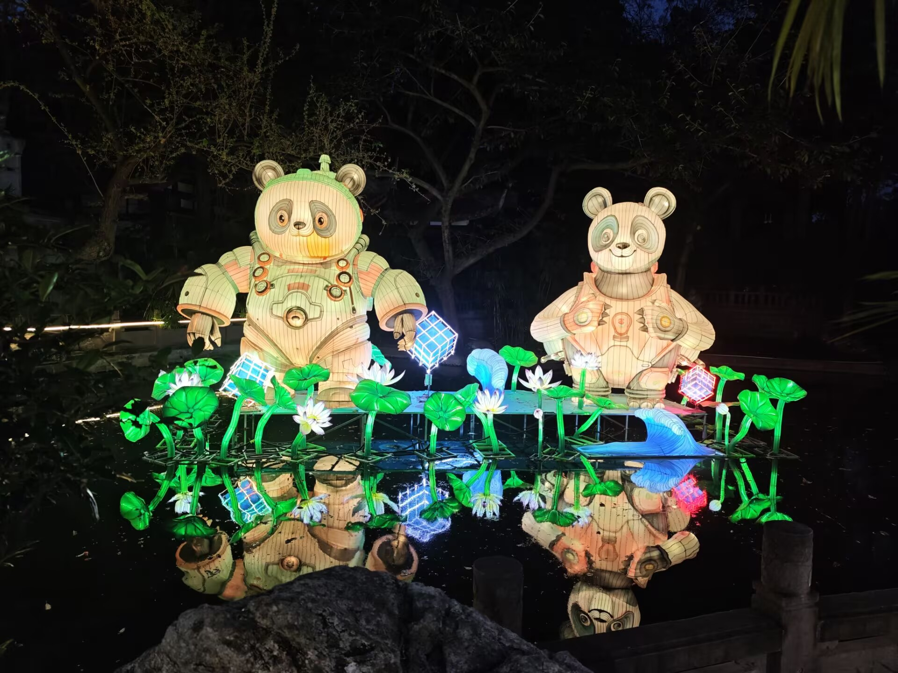
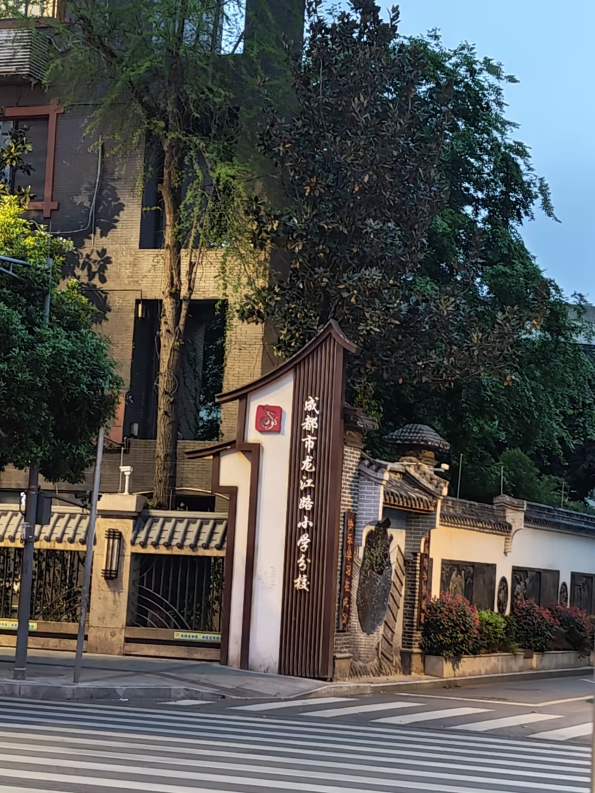

从武侯祠出来，旁边就是锦里。这条街白天是古街，晚上才是正片——灯笼全亮起来的时候，整条街都是暖红色的。

## 街口

门口一排大红灯笼，把「锦里」两个字衬得特别亮。天刚擦黑的时候最好看：天还剩一点蓝，灯笼的红刚好压得住。

## 水边的灯

街中段有片小水景，岸边的灯组倒映在水里，颜色比岸上还浓。

## 更多随拍

---

锦里不大，一两个小时就能走完，但很适合当一天的收尾：从武侯祠出来天刚好黑，逛着逛着就饿了，街口随便一家小吃都能填上。
