武侯祠是成都「三国味」最浓的地方——君臣合祀的格局全国独一份，刘备的惠陵、汉昭烈庙和纪念诸葛亮的武侯祠在同一片院落里。逛完三国，转头又能扎进盆景园，一天里一半是历史，一半是园林。

## 三义庙

三义庙纪念的是桃园结义的刘备、关羽、张飞。匾额和楹联都是老味道，殿内三尊塑像并排而坐。

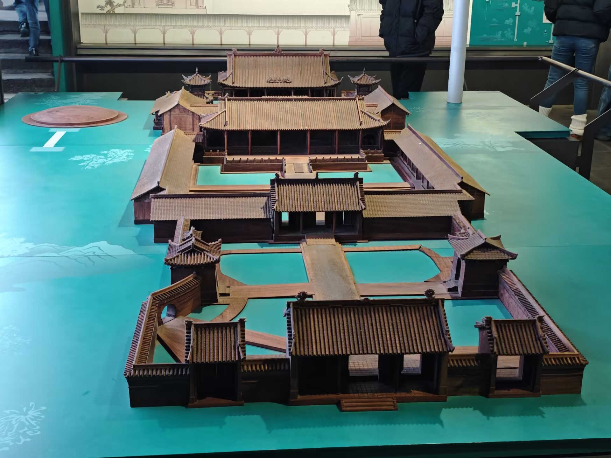

## 建筑模型

展厅里有一座整片祠庙的木制模型，飞檐、院墙、水榭都做得极细，站在模型前把刚才走过的路线又「飞」着看了一遍。

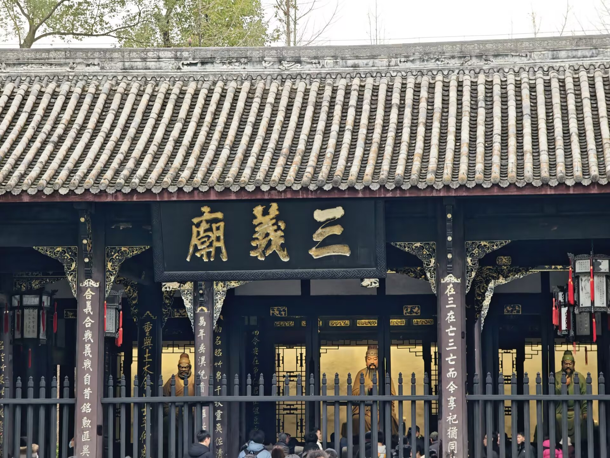

## 盆景园

祠内藏着一座盆景园，山石、苔藓、老桩摆出各种山水，红墙做背景，随便取景都好看。

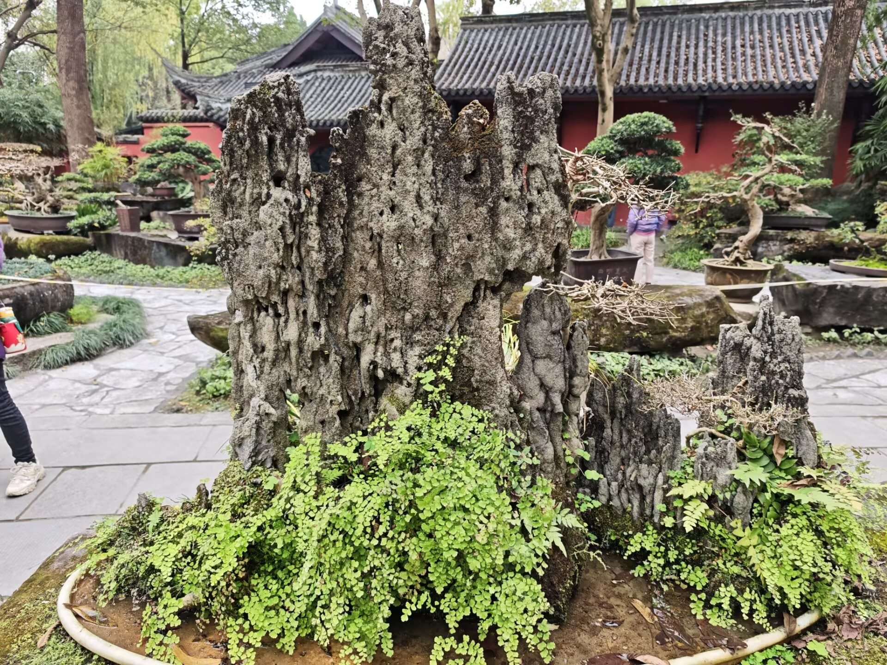

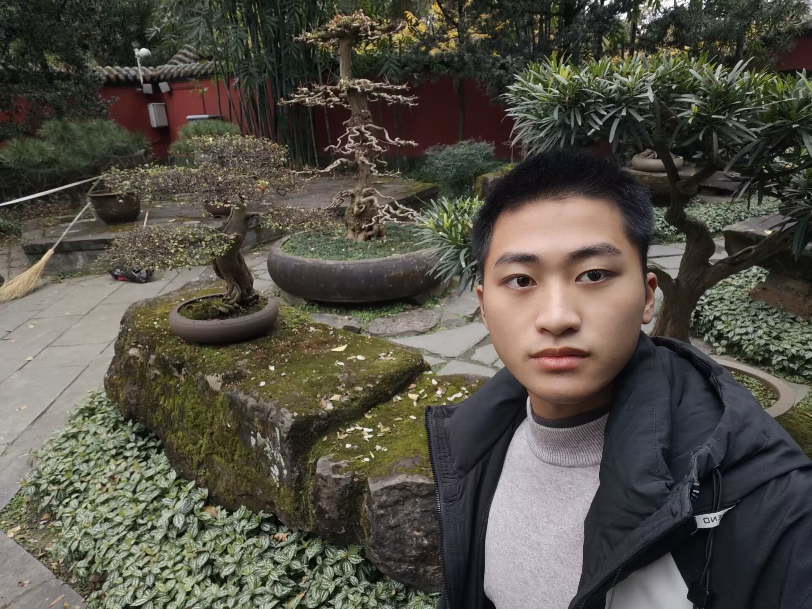

## 更多随拍

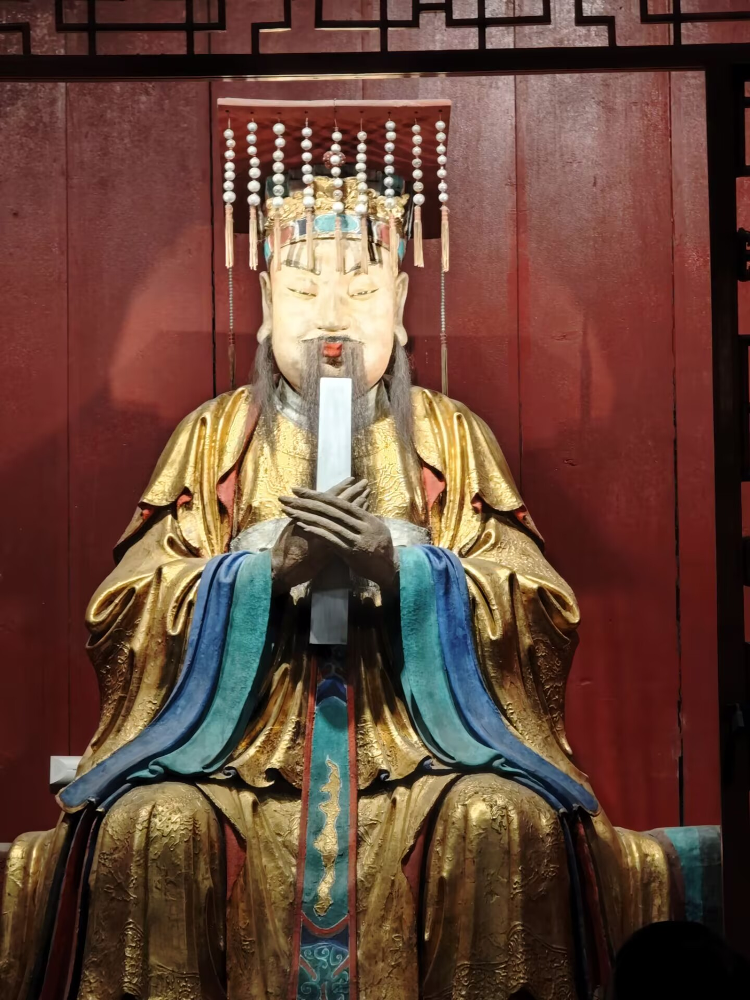

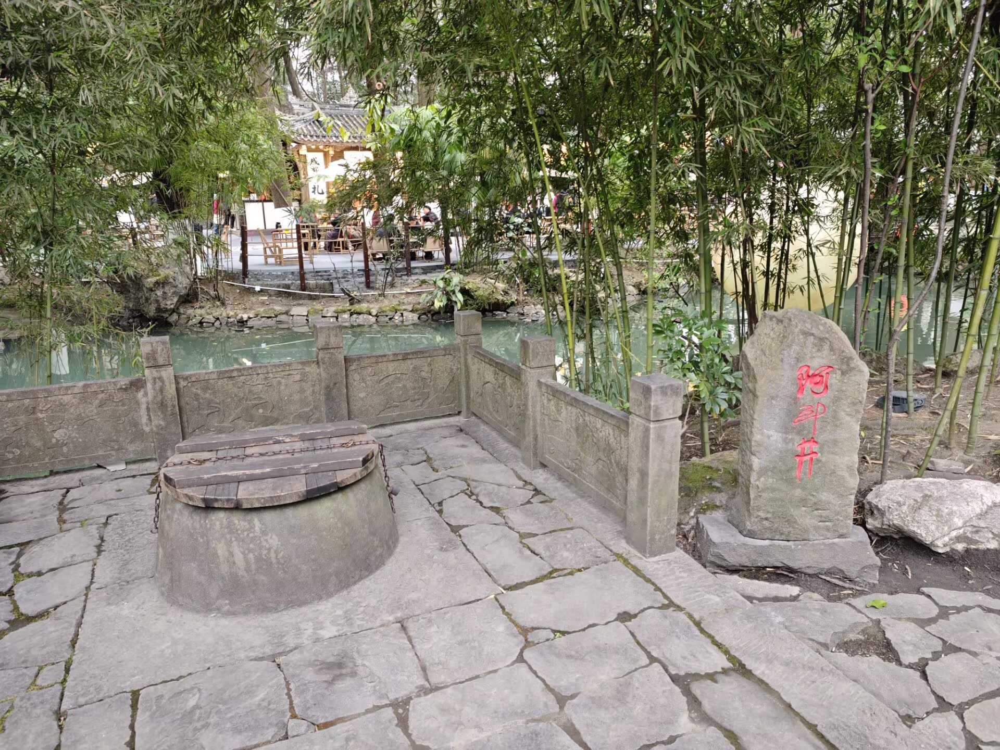

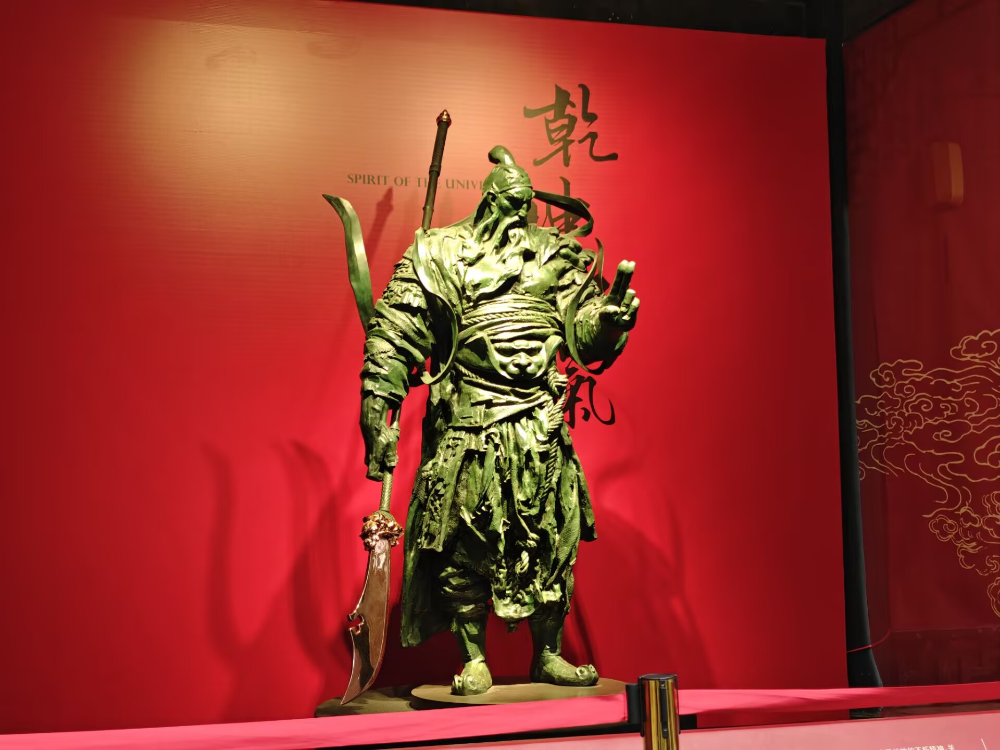

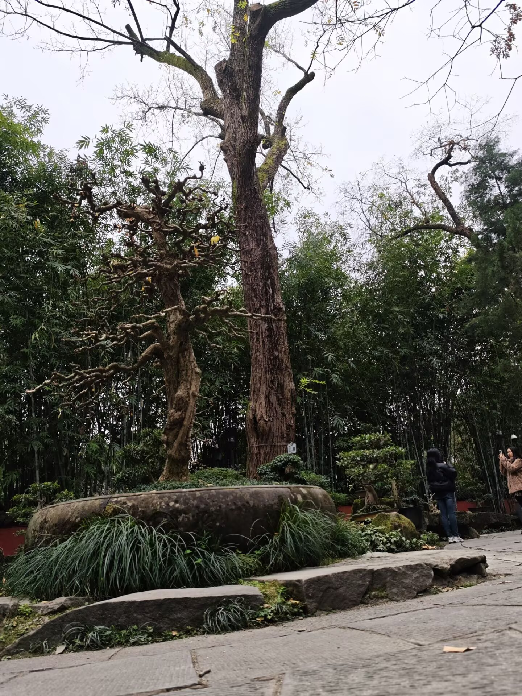

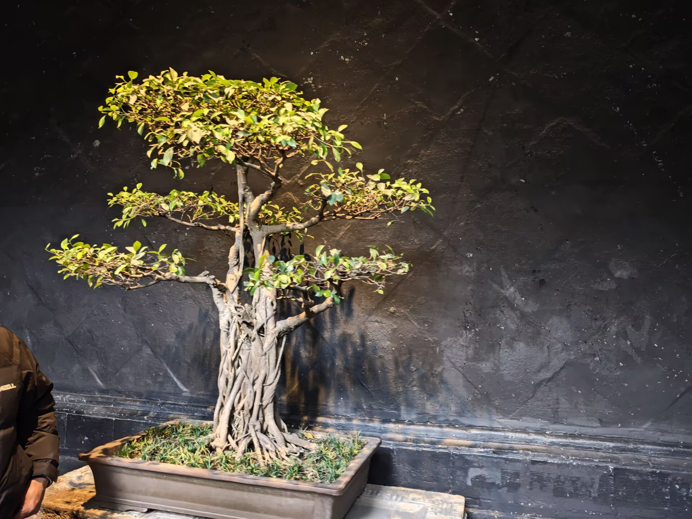

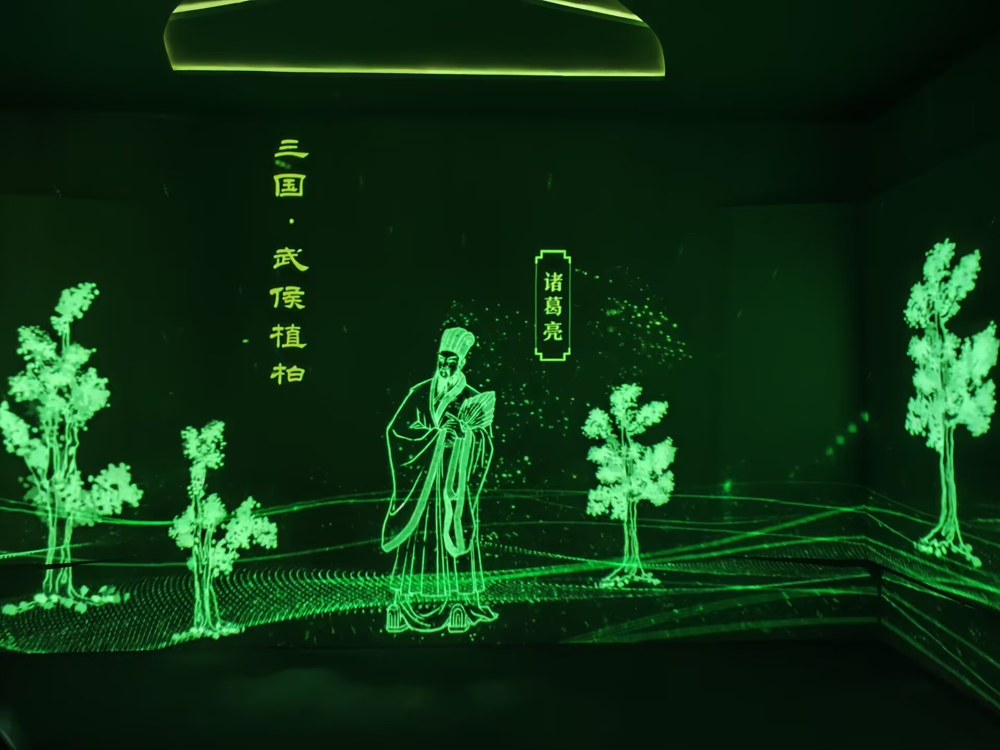

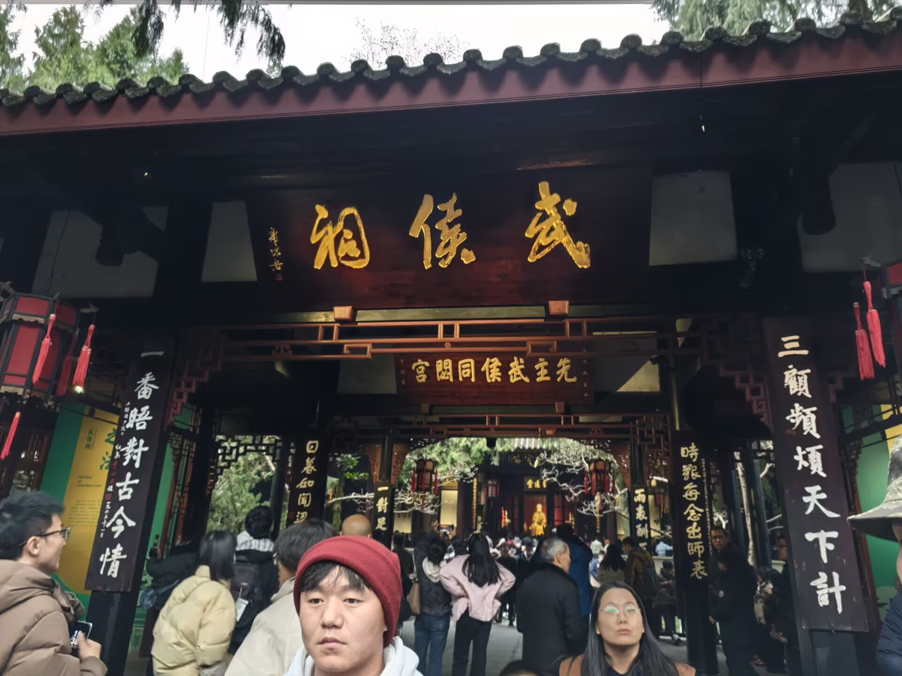

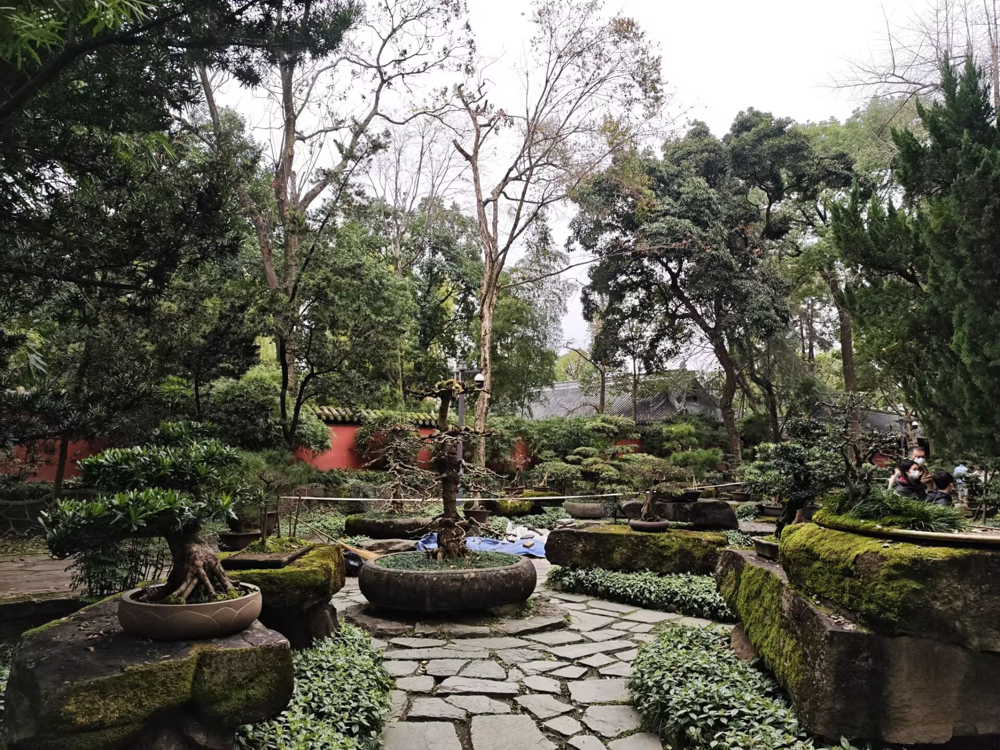

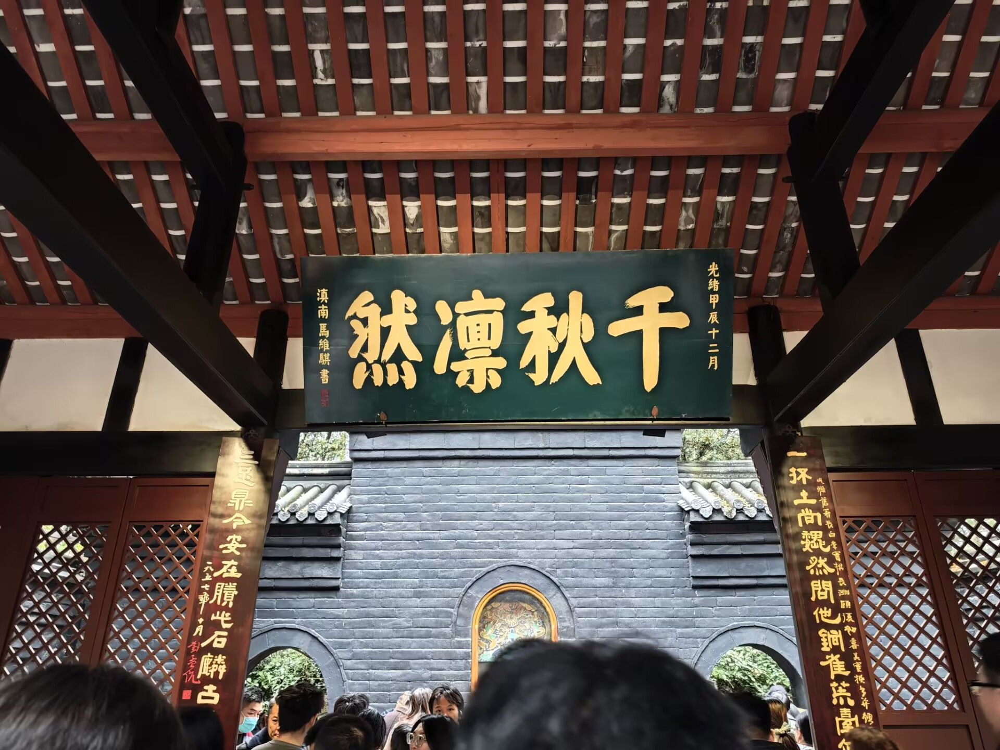

---

出来之后顺着红墙走到锦里，正好接上一顿晚饭——两处本来就是挨着的。
