「青城天下幽」，我们去的那天还下着雨。本以为天气要泡汤，结果雨中的青城山反而更对味——满山的水汽把绿意泡得更浓，溪水的声音也比晴天响。

## 栈道

山脚沿着溪流修了一段木栈道，下雨天人少，走在上面只有水声和雨点打伞的声音。前面的人套着一次性雨衣，倒也成了风景。

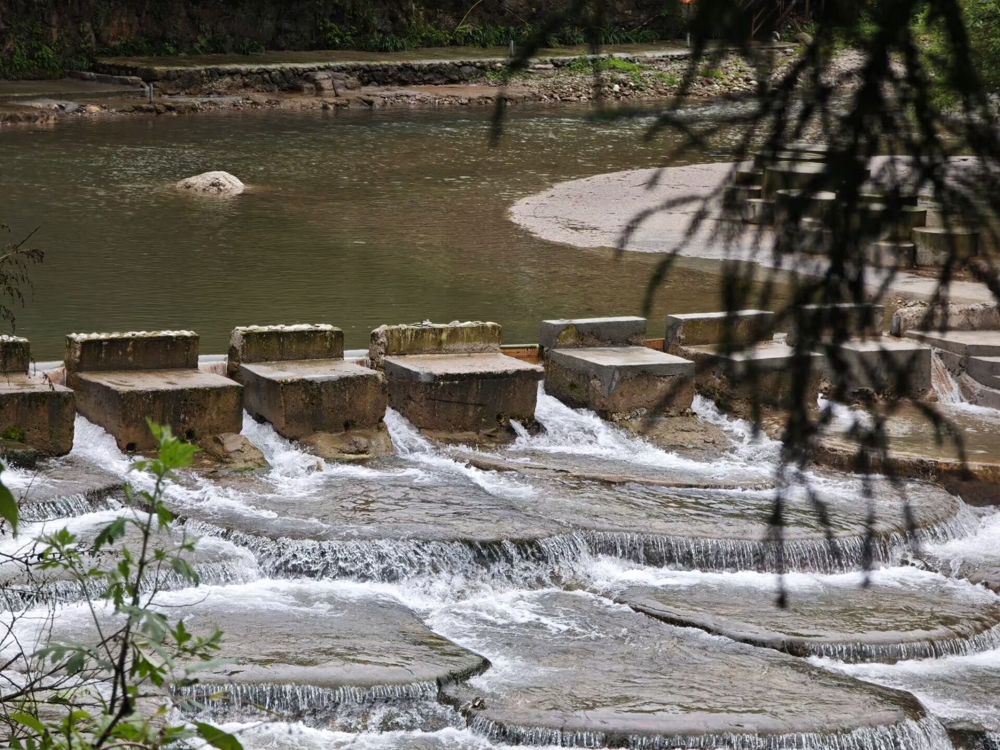

## 瀑布

半山处的瀑布比想象中壮观，几股水从岩壁上叠下来，底下汇成一汪碧色的小潭，围着不少撑伞拍照的人。

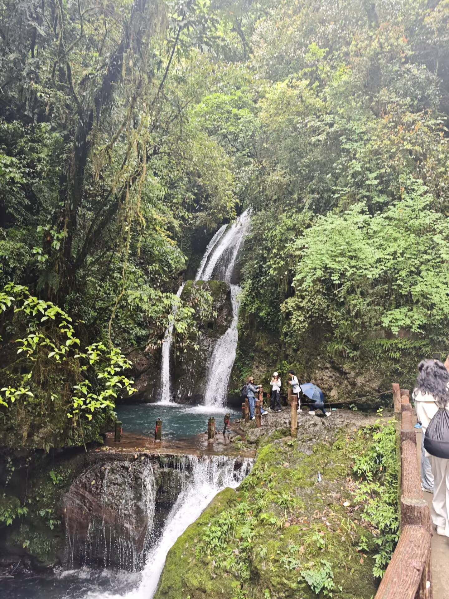

## 溪流

再往山下走，溪水被一道道石坝拦成分层的跌水，白花花的水从坝上漫过去。

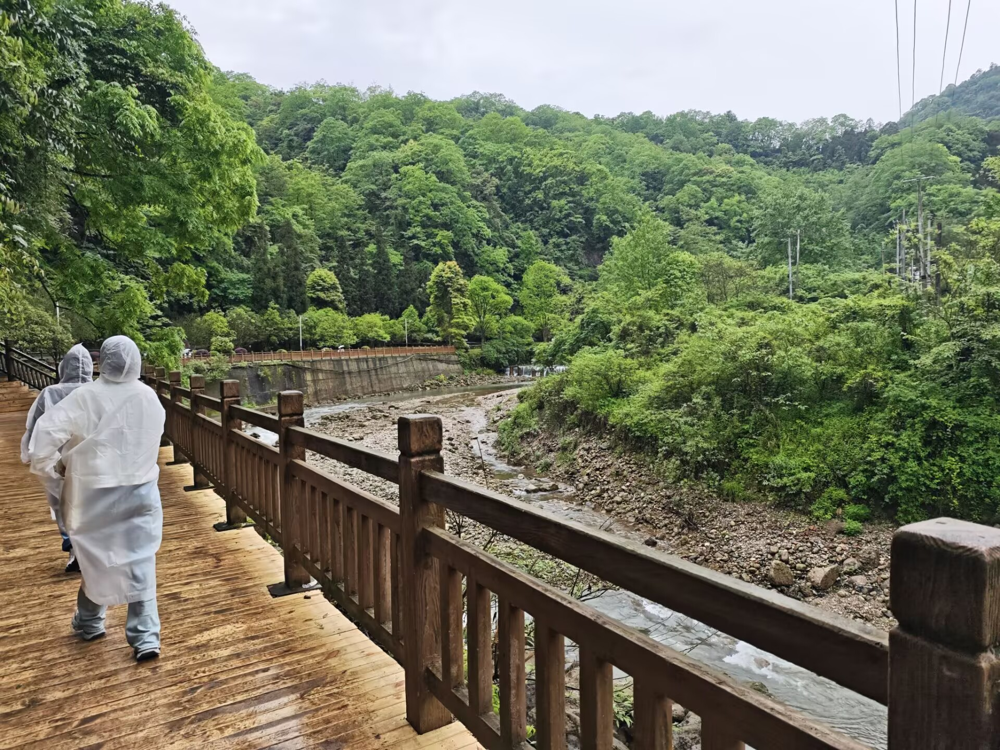

## 更多随拍

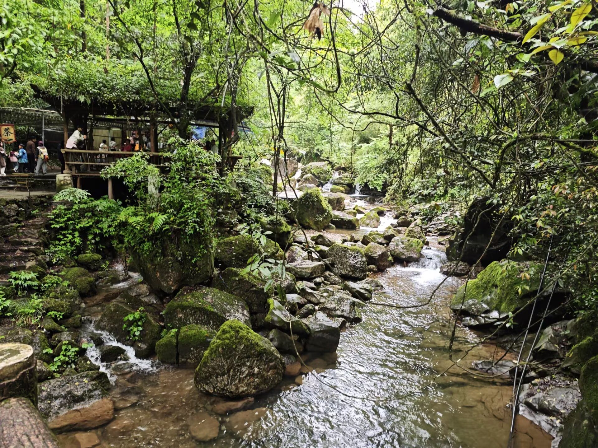

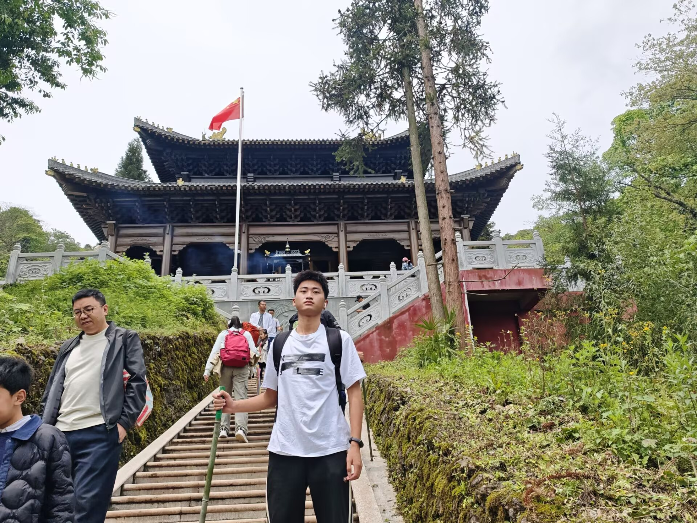

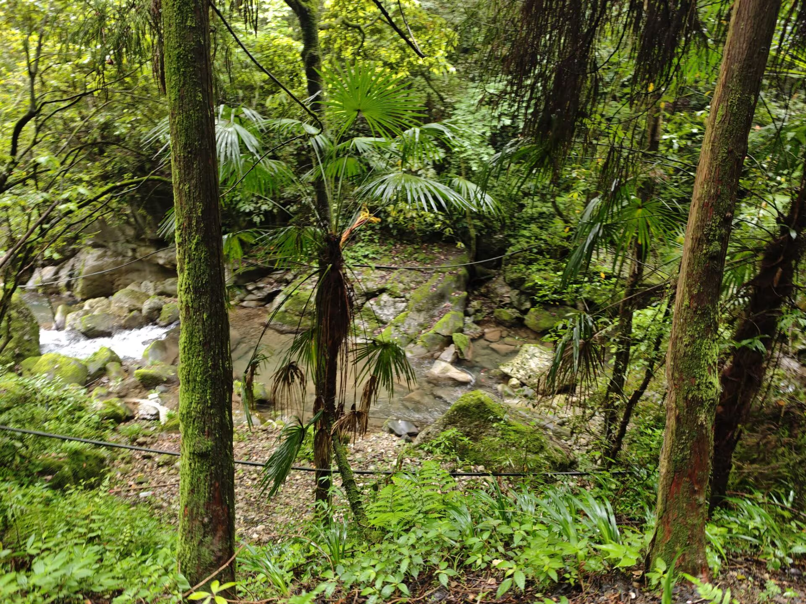

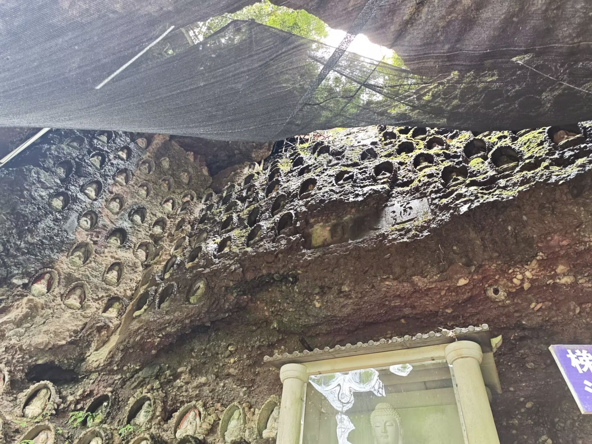

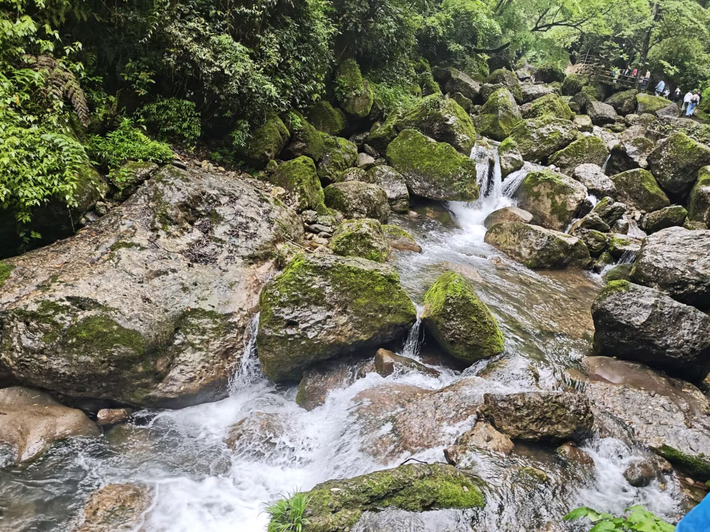

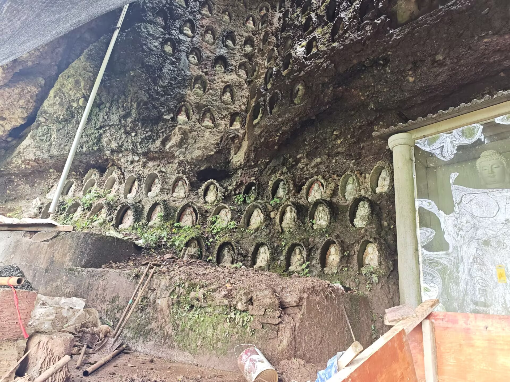

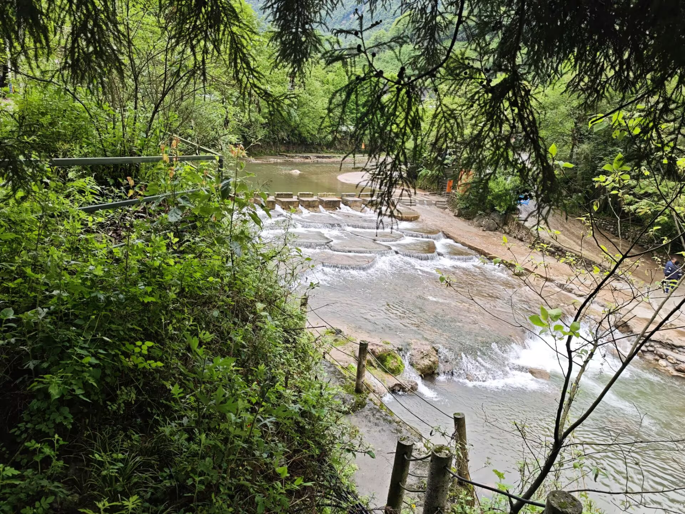

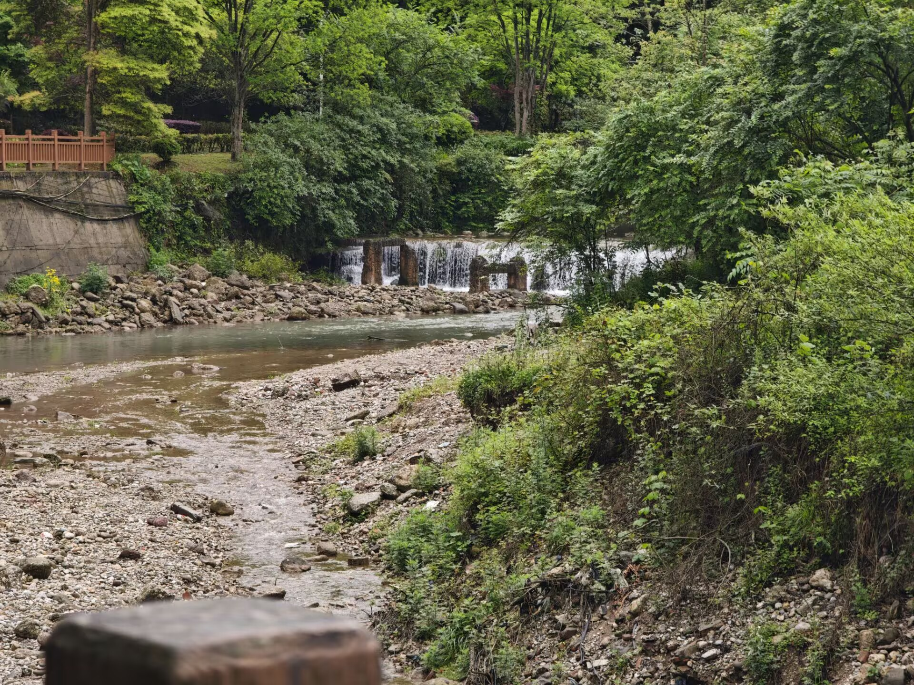

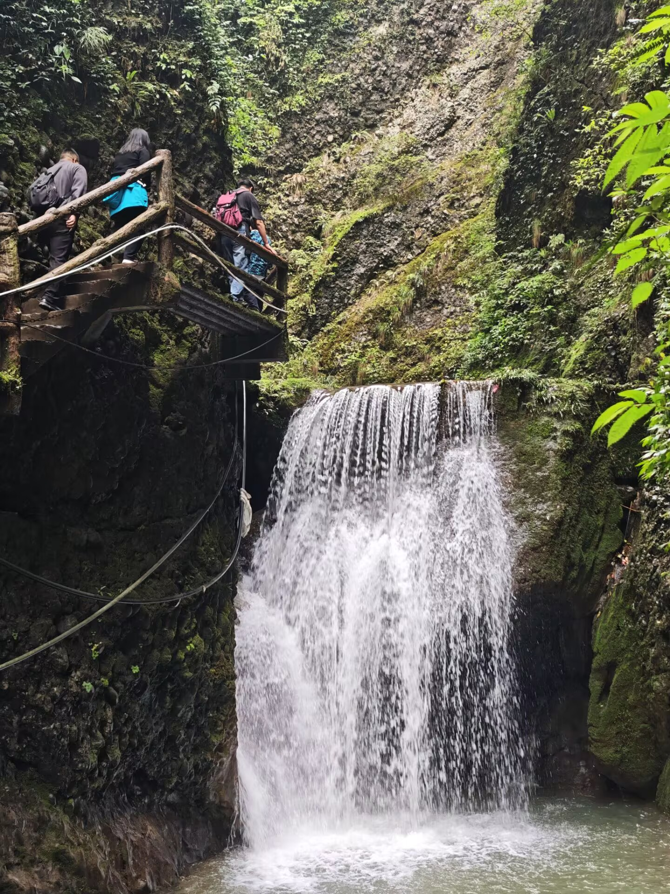

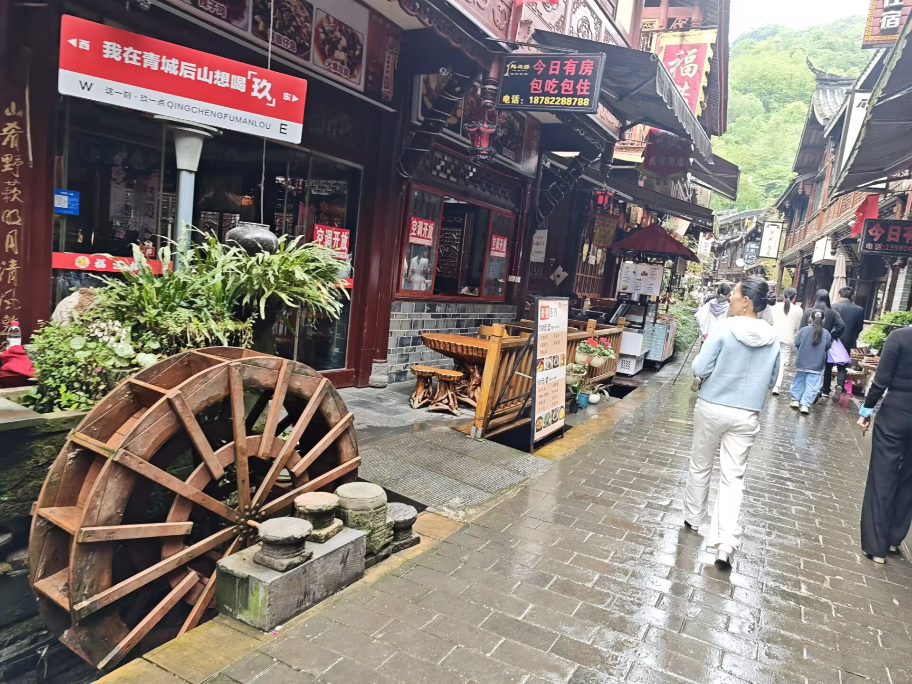

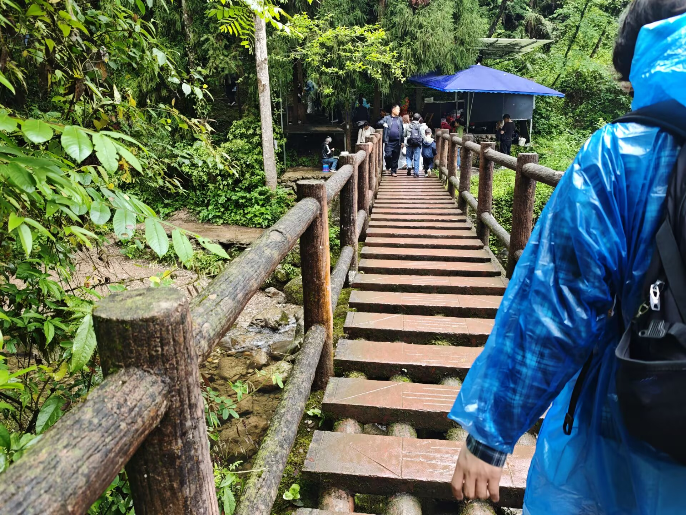

---

下山的时候雨还没停。鞋是湿的，但山也是湿的——雨天的青城山，值。
