趁着好天气去松山湖走了一圈。成片的欧式建筑沿着湖岸铺开，红砖城堡、钟楼、喷泉广场，还有哐当哐当绕镇一圈的小火车，走在里面有种一脚踏进欧洲小镇的错觉。

## 红砖城堡

最抓眼球的自然是那座「城堡」。红砖外墙爬着常春藤，倒映在湖面上，天气好的时候蓝天白云衬着，随手一拍都很出片。

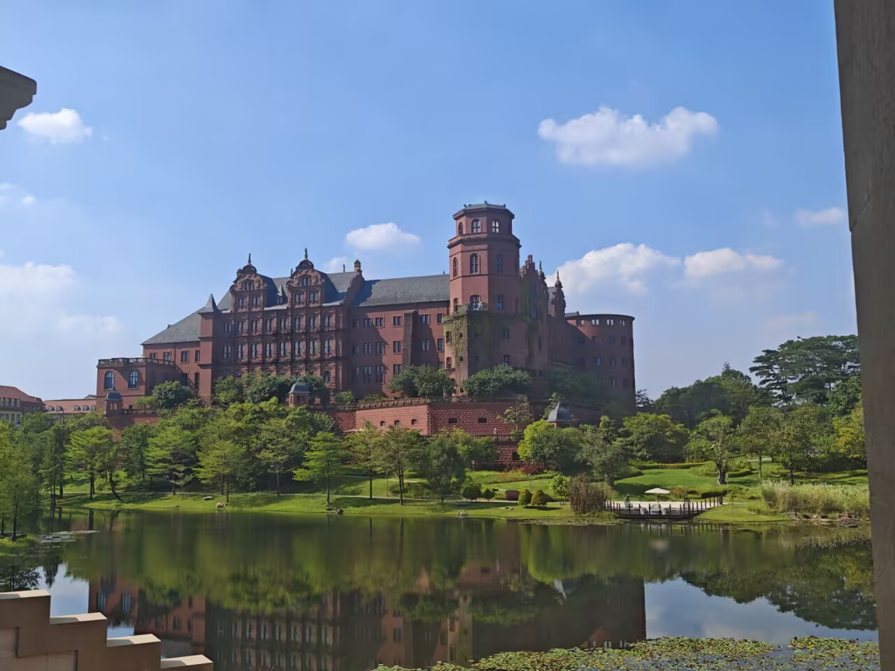

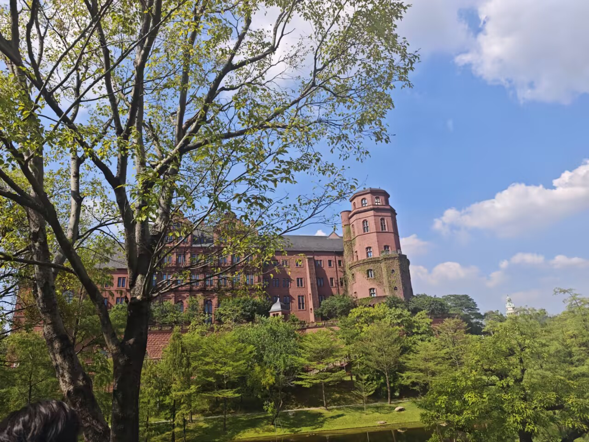

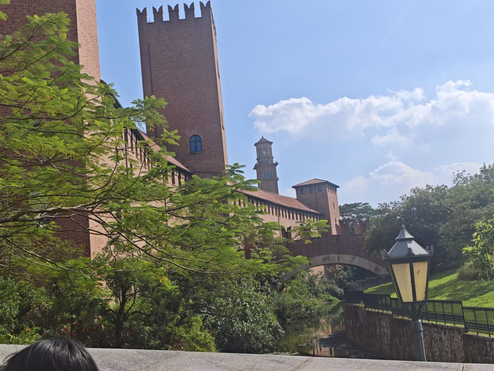

## 街区漫步

镇子里是窄窄的欧式街道，暖黄色的墙面、铁艺栏杆、街角的咖啡招牌，阳光从楼缝里斜下来，很有电影感。

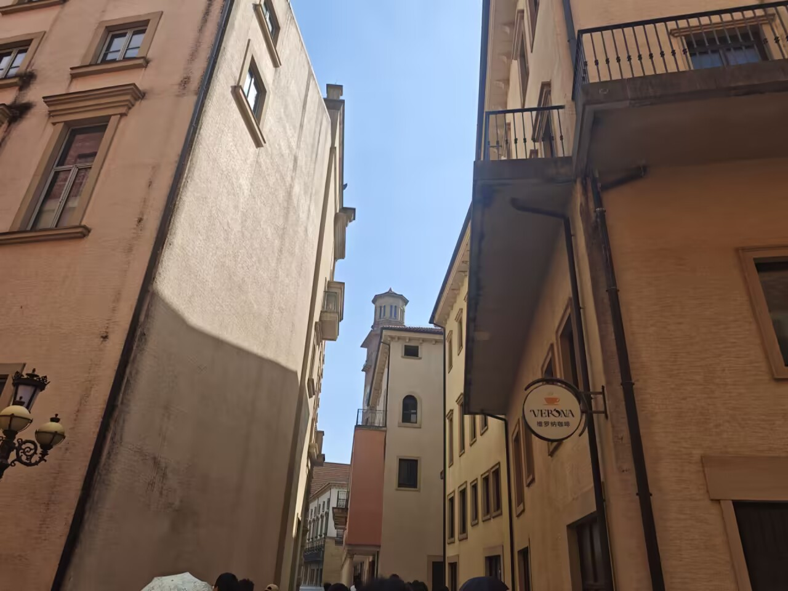

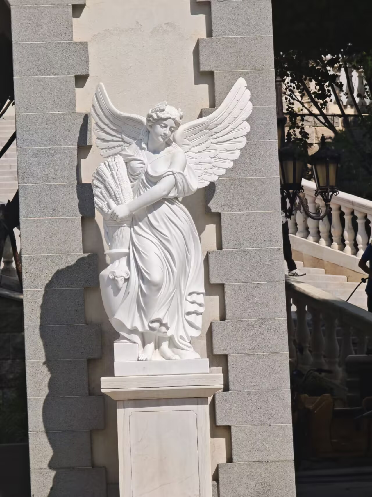

## 喷泉广场

广场中央的白色石雕喷泉层层叠叠，海马、人物雕像围成一圈，是整个镇子最「罗马」的地方。

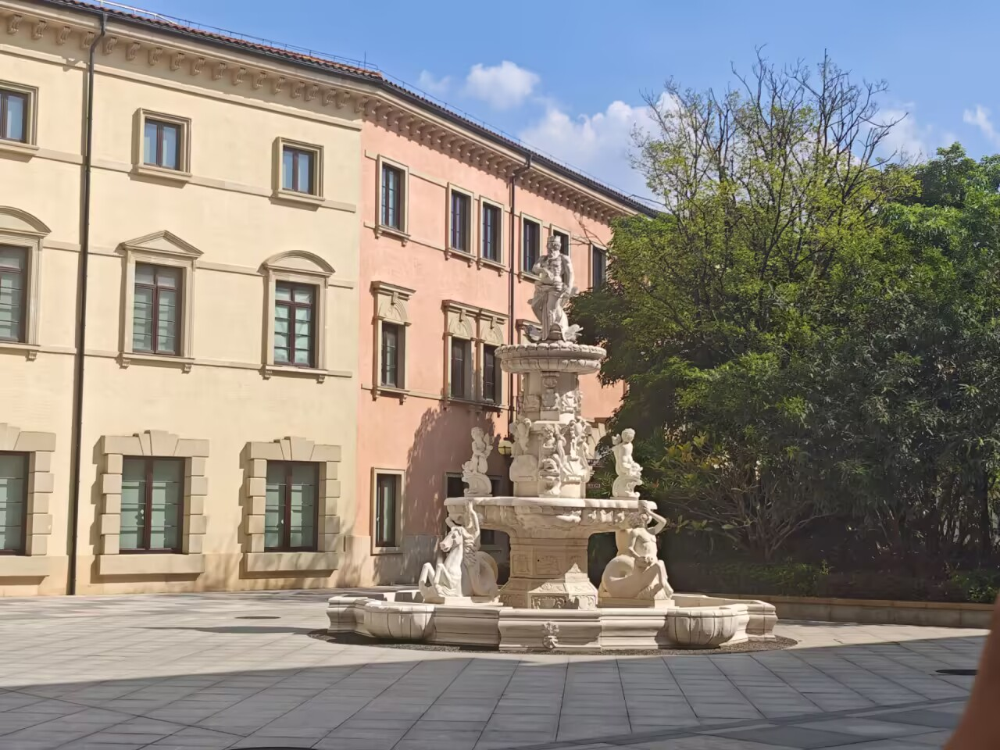

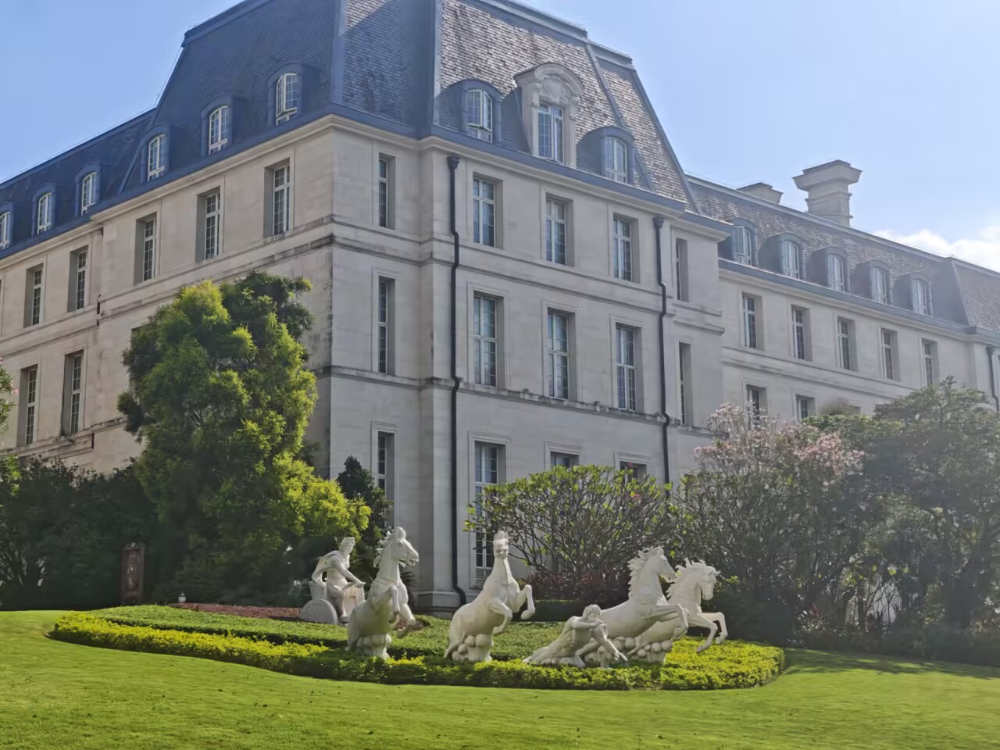

## 小火车与钟楼

橙色的小火车沿着轨道慢悠悠地绕镇行驶，穿过花架和铁艺楼梯；几座红砖钟楼藏在绿树后面，从拱门里望出去刚好框住塔尖。

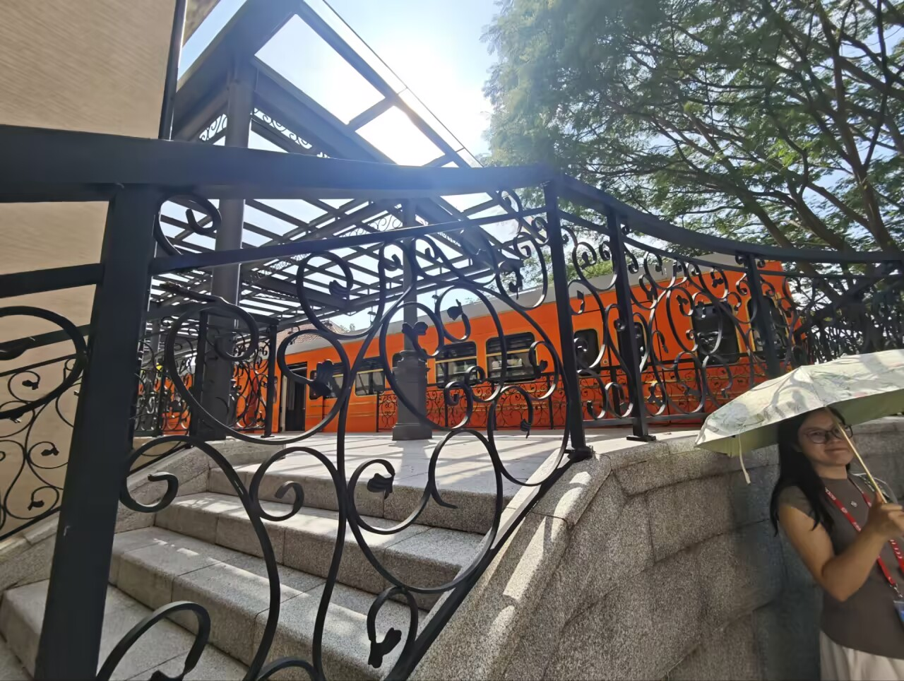

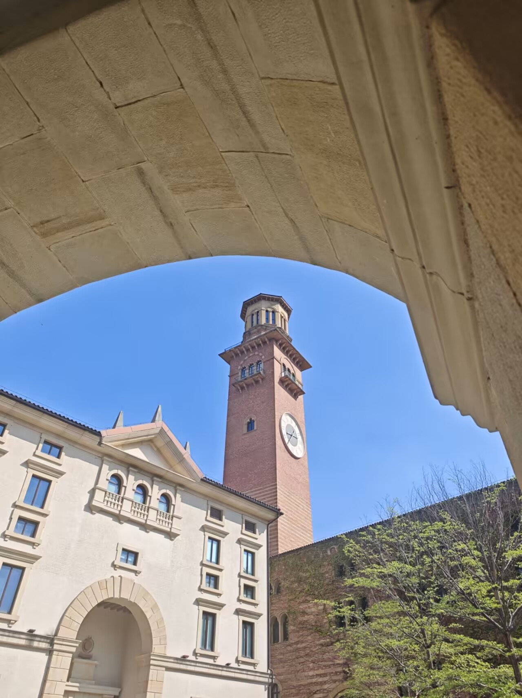

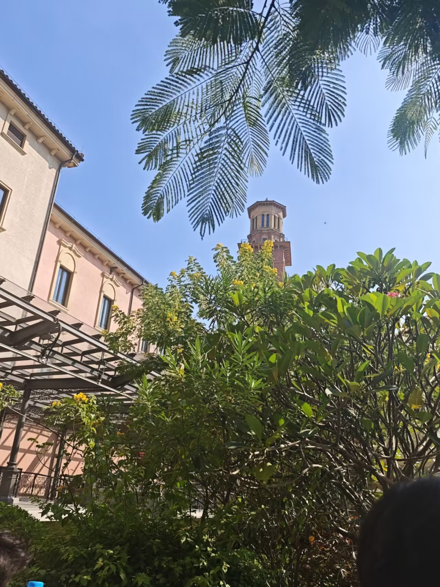

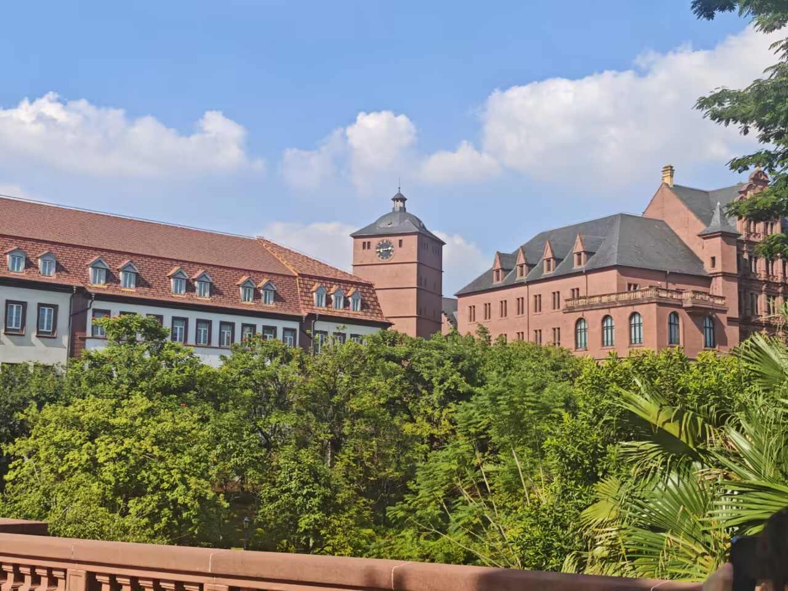

---

一次很松弛的散步式出游，拍的东西不多，但每一张都值得留下来。下次挑个傍晚再来，应该能看到湖面的落日。
